# Awesome School Information & Education Management (SIS) Software 🏫🎓

 
 

**A curated directory of top-tier School Information Systems (SIS), Education Management Systems (EMS), and Student Management Software — featuring commercial enterprise SaaS platforms and self-hosted open-source alternatives for K-12 districts, private academies, colleges, and higher education institutions.** 📚✨

[Explore SaaS Platforms](#-saas--hosted-platforms) • [Open-Source Solutions](#-open-source-software) • [Feature Matrix](#-feature-comparison-matrix) • [Market Dynamics](#-sector-overview--market-dynamics) • [Star History](#-star-history) • [Support](#-support) • [Contributing](#-contributing)

---

## 📖 Overview & SEO Summary 🔍

A **Student Information System (SIS)** — also known as a **Student Management System (SMS)**, **School ERP**, or **Education Management System (EMS)** — serves as the central digital operating system for academic institutions worldwide. Core functional pillars include:
- 🎓 **Student Lifecycles:** Admissions CRM, automated digital enrollment, student registration, demographic registers, and alumni relationship tracking.
- 🗓️ **Academic Operations:** Master class scheduling, constraint-based timetable solvers, curriculum catalogs, and classroom resource allocations.
- 📊 **Pedagogical Records:** Gradebooks, automated GPA/transcript generators, competency & standards-based assessments, and report card generation.
- 🏫 **Campus Administration:** Real-time attendance tracking, student billing, tuition financing, behavioral & discipline tracking, bus transit routing, and parent/student portals.

Whether you are comparing top commercial cloud providers like PowerSchool and Blackbaud or choosing a cost-efficient, self-hosted open-source system like RosarioSIS, Gibbon, or Frappe Education, this resource delivers side-by-side pricing models, company scale metrics, and technical architectural criteria.

---

## 📈 Sector Overview & Market Dynamics 🌐

The global Student Information System (SIS) and Education Management software market is currently valued between **$12.5 Billion and $13.5 Billion** (projected to exceed **$25 Billion by 2030** at a **CAGR of ~13-14%**). 

The industry is **moderately concentrated at the enterprise K-12 district tier**—led by major private equity-backed consolidators and incumbents such as PowerSchool (acquired by Bain Capital for $5.6B) and Nelnet/FACTS—yet remains **fragmented across regional markets and independent academies** where localized regulatory requirements, state reporting mandates, and open-source self-hosted solutions sustain a rich, multi-vendor ecosystem.

---

## 📋 Table of Contents 📑

- [Sector Overview & Market Dynamics](#-sector-overview--market-dynamics-)
- [SaaS / Hosted Platforms](#-saas--hosted-platforms-)
  - [SaaS SIS Providers Comparison Table](#saas-sis-providers-comparison-table)
  - [Provider Profiles](#provider-profiles)
- [Open-Source Software](#-open-source-software-)
  - [Open-Source SIS Repositories Ranked by Stars](#open-source-sis-repositories-ranked-by-stars)
  - [Open-Source Project Profiles](#open-source-project-profiles)
- [Feature Comparison Matrix](#-feature-comparison-matrix-)
- [Deployment & Architectural Considerations](#-deployment--architectural-considerations-)
- [Star History](#-star-history-)
- [Support & Community](#-support-)
- [Contributing](#-contributing-)
- [License](#-license-)

---

## 🟦 SaaS / Hosted Platforms ☁️

Commercial cloud-hosted School Information Systems deliver turn-key compliance, automated regulatory reporting, enterprise high-availability, and dedicated customer success teams. The table below outlines the leading SaaS SIS vendors sorted in descending order by company scale (valuation or parent revenue).

### SaaS SIS Providers Comparison Table

| Platform | Company Valuation / Revenue | Starting Price | Free Tier / Free Trial Limits | Target Market & Deployment |
| :--- | :--- | :--- | :--- | :--- |
| **[PowerSchool SIS](https://www.powerschool.com/)** | **$5.6B Valuation** ($698M FY23 Revenue; acquired by Bain Capital) | **$5.00 – $15.00 per student/year** (core SIS baseline quote; excludes setup & add-ons) | **No self-service free tier** (30-day sandbox demo available via sales consultation upon district validation) | Large public K-12 school districts, state education agencies, and regional boards |
| **[FACTS SIS](https://factsmgt.com/)** | **$4.5B Market Cap** (Division of Nelnet NYSE: NNI; ~$1.4B consolidated revenue) | **$1,000.00/year base platform fee** (plus $25–$55/family tuition setup fees) | **No free tier** (Custom guided sandbox demo available upon scheduling with sales engineers) | Private, independent, and faith-based K-12 schools requiring integrated tuition collection |
| **[Blackbaud SIS](https://www.blackbaud.com/)** | **$3.75B Market Cap** (NASDAQ: BLKB; ~$1.16B annual revenue) | **$5,000.00/year base contract** (scales with student enrollment and CRM suite modules) | **No free tier** (Interactive guided product tour and personalized pilot demo by request) | Independent private schools, boarding academies, and university prep institutions |
| **[Infinite Campus](https://www.infinitecampus.com/)** | **$150M – $300M Annual Revenue** (Independent market leader; privately held) | **$5.00 – $12.00 per student/year** (tiered volume model where per-pupil rates decrease at scale) | **No free tier** (Custom district staging pilot with synthetic data available on request) | Mid-to-mega K-12 public school districts and statewide student data deployments |
| **[Skyward](https://www.skyward.com/)** | **~$80M Annual Revenue** (Privately held K-12 administrative software leader) | **$30,000.00/year base package** (combined SIS & ERP/business suite licensing) | **No free tier** (District discovery session and feature demo access on demand) | Medium-to-large public school districts requiring tight SIS + payroll/HR ERP synchronization |
| **[Veracross](https://www.veracross.com/)** | **$25M – $39M Annual Revenue** (Private equity-backed by Harvest Partners) | **$500.00/month starting tier** (~$6,000/year for single-office modules; scales with student headcount) | **No free tier** (Personalized administrative demo walkthrough provided by sales consultants) | Elite independent day schools, international academies, and selective boarding schools |
| **[Alma SIS](https://www.getalma.com/)** | **$5M – $10M Annual Revenue** (Privately held venture-backed SIS) | **$3.50 – $7.00 per student/year** (minimum annual contract threshold applies) | **No free tier** (Interactive feature demonstration session provided upon request) | Small-to-medium public districts, charter schools, and forward-thinking private academies |
| **[Classter](https://www.classter.com/)** | **~$1M Annual Revenue** (Global modular SaaS provider) | **€8.50 per student/year** (~$9.20/student for Core SIS; €6.50/student for LMS module) | **14-day free trial** (Full sandbox access for up to 50 student test profiles) | K-12 private schools, vocational colleges, higher education, and international training institutes |

### Provider Profiles

#### PowerSchool SIS 🏢
* **Architecture:** Multi-tenant enterprise cloud.
* **Core Strengths:** Long-standing North American market leader with state compliance reporting engines across all 50 US states and Canadian provinces. Deep interoperability with Schoology LMS, PowerBuddy AI, and Naviance college readiness.
* **Considerations:** Implementation and data migration often require lengthy timelines and substantial professional services contracts ($10,000 to $50,000+).

#### FACTS SIS (formerly RenWeb) 💳
* **Architecture:** Cloud-hosted portal environment.
* **Core Strengths:** Seamless pairing between Student Information Systems and tuition financing/processing via Nelnet. Eliminates reconciliation friction between academic registrar records and school business offices.
* **Considerations:** Many features and portal apps pass per-family processing charges to parents.

#### Blackbaud SIS 🏛️
* **Architecture:** Blackbaud SKY cloud infrastructure.
* **Core Strengths:** Unified data environment linking admissions, academic grading, donor fundraising, endowment tracking, and alumni relations.
* **Considerations:** Tailored exclusively to private/independent budgets; complex setup process.

#### Infinite Campus 🌐
* **Architecture:** Scalable web-based district database.
* **Core Strengths:** Exceptional state-level reporting, integrated gradebook, real-time parent/student notification engine, and modular food service & bus transportation extensions.
* **Considerations:** User interface prioritized for administrative power users; can feel heavy for small individual schools.

#### Skyward ⚙️
* **Architecture:** Enterprise school database suite (SMS 2.0 & Qmlativ).
* **Core Strengths:** Bridges education management with school district business functions (payroll, human capital, procurement, and general ledger accounting).
* **Considerations:** Significant upfront implementation overhead; best suited for district-wide consolidations.

#### Veracross 🎯
* **Architecture:** Single-record relational cloud architecture.
* **Core Strengths:** Zero duplicate student records; CRM, admissions, academics, billing, and health data share a unified core entity table.
* **Considerations:** Premium pricing structure; focused primarily on independent and private education.

#### Alma SIS 💡
* **Architecture:** Modern responsive cloud application.
* **Core Strengths:** Clean, intuitive UI/UX requiring minimal training for instructional staff. Supports traditional letter grades, mastery/competency-based grading, and hybrid models.
* **Considerations:** Smaller partner integration ecosystem relative to legacy enterprise giants.

#### Classter 🌍
* **Architecture:** All-in-one modular cloud ERP/SIS.
* **Core Strengths:** Highly transparent modular pricing; combines Student Information System, Learning Management System, and admissions CRM in a configurable portal.
* **Considerations:** Originates from European education framework; US state-specific compliance requires validation.

---

## 🟩 Open-Source Software 🔓

Self-hosted and open-source School Information Systems give educational institutions absolute control over student privacy, FERPA/GDPR compliance, custom database schemas, and hosting expenditures.

The table below features top open-source SIS and School Management platforms, sorted in descending order by **GitHub Star Count**. Every badge links directly to that project's stargazers community.

### Open-Source SIS Repositories Ranked by Stars

| Project & Repo | Stars | Primary Tech Stack | License | Key Focus & Use Case |
| :--- | :--- | :--- | :--- | :--- |
| **[Unifiedtransform](https://github.com/changeweb/Unifiedtransform)** |  | PHP / Laravel / Vue.js | MIT | Feature-packed modern school ERP for admissions, exams, timetables, and student finances. |
| **[LAVSMS](https://github.com/4jean/lav_sms)** |  | PHP / Laravel / Bootstrap | MIT | Clean Laravel-based student information and administrative records management platform. |
| **[School Management System](https://github.com/hrshadhin/school-management-system)** |  | PHP / CodeIgniter / MySQL | Open Source | Complete academic operations system with student profiles, staff directories, and exam marks. |
| **[OpenEduCat](https://github.com/openeducat/openeducat_erp)** |  | Python / Odoo / PostgreSQL | LGPL-3.0 | Comprehensive enterprise education ERP leveraging Odoo for invoicing, HR, CRM, and SIS. |
| **[Frappe Education](https://github.com/frappe/education)** |  | Python / ERPNext / MariaDB | GPL-3.0 | Modern modular education suite integrated into ERPNext for schools, polytechnics, and colleges. |
| **[RosarioSIS](https://github.com/francoisjacquet/rosariosis)** |  | PHP / PostgreSQL / Apache | GPL-2.0 | Lightweight, production-proven K-12 SIS deployable on modest VPS instances with full grading & attendance. |
| **[Gibbon](https://github.com/GibbonEdu/core)** |  | PHP / MySQL / Twig | GPL-3.0 | Flexible, teacher-focused international school management platform maintained continuously since 2010. |
| **[Django School Management](https://github.com/TareqMonwer/Django-School-Management)** |  | Python / Django / Bootstrap | Open Source | Web-based SIS covering online admissions, student dues, fee payments, and academic grade reports. |
| **[Skuul](https://github.com/yungifez/skuul)** |  | PHP / Laravel 13 / Livewire 4 | MIT | Modern multi-organization and multi-campus SIS featuring team-scoped roles and family portals. |
| **[Django SMS (Adigun)](https://github.com/adigunsherif/Django-School-Management-System)** |  | Python / Django / SQLite / PostgreSQL | MIT | Clean Django school system with grade computation, attendance logging, and session terms. |
| **[Student Management (Jobic10)](https://github.com/jobic10/student-management-using-django)** |  | Python / Django / JavaScript | MIT | Educational platform combining course add/drop, quiz management, and automated report generation. |
| **[openSIS Classic](https://github.com/OS4ED/openSIS-Classic)** |  | PHP / MySQL / Bootstrap | GPL-2.0 | Commercial-grade K-12 district SIS with constraint-based scheduling, transcripts, and bus route tracking. |
| **[FenixEdu Academic](https://github.com/FenixEdu/fenixedu-academic)** |  | Java / Spring / MySQL | LGPL-3.0 | Enterprise higher education SIS developed for university campuses and academic Bologna compliance. |
| **[Vidra](https://github.com/sandeeep-prajapati/Vidra)** |  | Python / Django / SQLite | Open Source | Extensible Django school platform with student records, class sections, and IoT/AI integration hooks. |
| **[AlekSIS](https://edugit.org/AlekSIS)** | *(EduGit FLOSS)* | Python / Django / Vue.js | EUPL-1.2+ | Fully libre European school information system hosted on independent EduGit infrastructure. |

### Open-Source Project Profiles

#### RosarioSIS 🚀
* **Stack:** PHP 8+ / PostgreSQL.
* **Why It Stands Out:** Unrivaled resource efficiency. Unlike heavy ERP distributions, RosarioSIS can run smoothly on an entry-level VPS ($5/month). Ships out of the box with scheduling, discipline logs, gradebooks, attendance, student billing, and multi-school district capabilities.
* **Ideal For:** Small-to-midsize schools, budget-constrained private academies, and NGOs wanting standard K-12 workflows without bloated infrastructure bills.

#### openSIS 🚌
* **Stack:** PHP 8+ / MySQL.
* **Why It Stands Out:** Designed specifically for institutional scale. Features a constraint-driven scheduling engine, transcripts, medical/health tracking, and an integrated **student transportation module** for district bus routes.
* **Ideal For:** District administrators needing enterprise SIS capabilities with self-hosted control and REST API integrations.

#### Gibbon 📚
* **Stack:** PHP 8+ / MySQL / Twig templating.
* **Why It Stands Out:** Founded and maintained by active educators since 2010. Emphasizes teacher ergonomics with intuitive planning tools, behavior tracking, rubrics, and timetable builders.
* **Ideal For:** International schools and educators seeking an adaptable, mature platform backed by an active global community.

#### Frappe Education 📦
* **Stack:** Python / Frappe Framework / MariaDB.
* **Why It Stands Out:** Directly inherits the full power of ERPNext (general ledger, payroll, fixed asset management, and CRM). Unifies student fee invoicing and academic progression with institutional bookkeeping.
* **Ideal For:** Vocational institutes, colleges, and schools seeking an all-in-one ERP that eliminates third-party accounting sync tools.

#### OpenEduCat 🎓
* **Stack:** Python / Odoo ORM / PostgreSQL.
* **Why It Stands Out:** Bridges education administration with Odoo's vast modular ecosystem (inventory, recruitment, human resources, POS, and website builders).
* **Ideal For:** Institutions already utilizing or evaluating Odoo as their central enterprise operational platform.

#### Skuul ⚡
* **Stack:** PHP / Laravel 13 / Livewire 4 / MySQL / Redis.
* **Why It Stands Out:** Built using the latest modern PHP ecosystem standards. Supports multi-tenancy across independent campuses, team-scoped role security (Spatie), and modern Livewire frontends.
* **Ideal For:** Developers and modern school groups seeking an MIT-licensed, developer-friendly framework codebase.

---

## 📊 Feature Comparison Matrix 📋

| Platform | Deployment Mode | License | K-12 Focus | Higher Ed Focus | Parent & Student Portal | Gradebook & Transcripts | Finance & Billing |
| :--- | :--- | :--- | :---: | :---: | :---: | :---: | :---: |
| **PowerSchool SIS** | Cloud SaaS | Proprietary | ✅ | ❌ | ✅ | ✅ | Integrated / Add-on |
| **FACTS SIS** | Cloud SaaS | Proprietary | ✅ | ❌ | ✅ | ✅ | Native Nelnet Core |
| **Blackbaud SIS** | Cloud SaaS | Proprietary | ✅ | ✅ | ✅ | ✅ | Integrated Blackbaud Pay |
| **Infinite Campus** | Cloud SaaS | Proprietary | ✅ | ❌ | ✅ | ✅ | Optional Suite Module |
| **Skyward** | Cloud / Hosted | Proprietary | ✅ | ❌ | ✅ | ✅ | Native ERP Suite |
| **Veracross** | Cloud SaaS | Proprietary | ✅ | ❌ | ✅ | ✅ | Native Single-Database |
| **Alma SIS** | Cloud SaaS | Proprietary | ✅ | ❌ | ✅ | ✅ | Third-party Integrations |
| **Classter** | Cloud SaaS | Proprietary | ✅ | ✅ | ✅ | ✅ | Native Core Module |
| **RosarioSIS** | Self-Hosted | GPL-2.0 | ✅ | ✅ | ✅ | ✅ | Native Billing Module |
| **openSIS** | Self-Hosted | GPL-2.0 | ✅ | ❌ | ✅ | ✅ | Fee Portal / Stripe API |
| **Gibbon** | Self-Hosted | GPL-3.0 | ✅ | ❌ | ✅ | ✅ | Native Finance Module |
| **Frappe Education** | Self-Hosted / Cloud | GPL-3.0 | ✅ | ✅ | ✅ | ✅ | Full ERPNext General Ledger |
| **OpenEduCat** | Self-Hosted / Cloud | LGPL-3.0 | ✅ | ✅ | ✅ | ✅ | Full Odoo Accounting |
| **Skuul** | Self-Hosted | MIT | ✅ | ❌ | ✅ | ✅ | Native Financial Ledger |
| **FenixEdu** | Self-Hosted | LGPL-3.0 | ❌ | ✅ | ✅ | ✅ | Academic Administrative |

---

## 🏗 Deployment & Architectural Considerations 🛠️

When selecting between SaaS and self-hosted open-source school software, evaluate the following factors:

1. 🔒 **Data Sovereignty & Compliance:**
   - Public school districts in the US must ensure compliance with **FERPA**, **COPPA**, and state-specific student data privacy compacts.
   - International institutions must comply with **GDPR** or local personal data protection acts. Self-hosted deployments (e.g., RosarioSIS, AlekSIS, Gibbon) ensure student records never leave institutional servers.

2. 💰 **Total Cost of Ownership (TCO):**
   - **SaaS:** Predictable annual subscription with zero server maintenance overhead, though per-pupil licensing accumulates significantly as student enrollment scales past thousands of pupils.
   - **Open-Source:** Zero licensing fees, but requires system administration expertise, database backups, automated patch management, and SSL certificate maintenance.

3. 🔄 **Interoperability & Open Standards:**
   - Look for standard integration support such as **OneRoster**, **LTI (Learning Tools Interoperability)**, and **Ed-Fi** data standards for smooth synchronization with Learning Management Systems (Canvas, Google Classroom, Moodle).

---

## 📈 Star History 🌟

---

## 💖 Support & Community ☕

Thank you for visiting and supporting this curated collection! If you find this directory valuable for your school district, research, or development projects, please consider:

- ⭐ **Starring this repository** on GitHub to help others discover it.
- 🍴 **Forking and sharing** with educational technology directors and teachers.
- 💬 **Joining our Discord community** to discuss open-source and edtech tooling.
- ☕ **Sponsoring the maintainer** or buying a coffee via the [GitHub Sponsors Dashboard](https://github.com/sponsors/ishandutta2007).

Your backing ensures these curated lists stay maintained, verified, and continuously up to date! 🙌

---

## 🤝 Contributing 💡

Contributions are warmly welcomed! Help keep this directory comprehensive and up to date:

1. **Check Existing Listings:** Search the table above to ensure the platform isn't already documented.
2. **Review Criteria:** 
   - SaaS solutions must have established deployment records in educational institutions.
   - Open-source software must be actively maintained (commit activity within the last 12 months) and open source under an OSI-approved license.
3. **Format PR:** Submit pull requests following the table styling and include:
   - Tool name and official URL.
   - Primary tech stack and license.
   - Concise 1–2 sentence description highlighting core differentiators.

Please see our [Contributing Guidelines](CONTRIBUTING.md) for details.

---

## 📄 License 📜

This compilation is released under the [Creative Commons Zero v1.0 Universal](LICENSE) (Public Domain Dedication).  
Individual platforms, trademarks, and repositories remain under their respective proprietary or open-source licenses.

---

⭐ **Found this guide helpful? Give the repository a star!** ⭐

